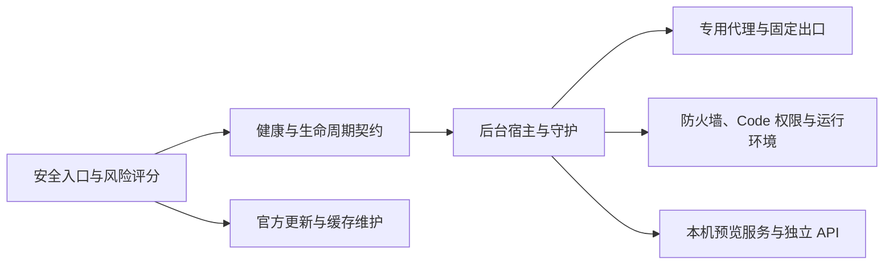
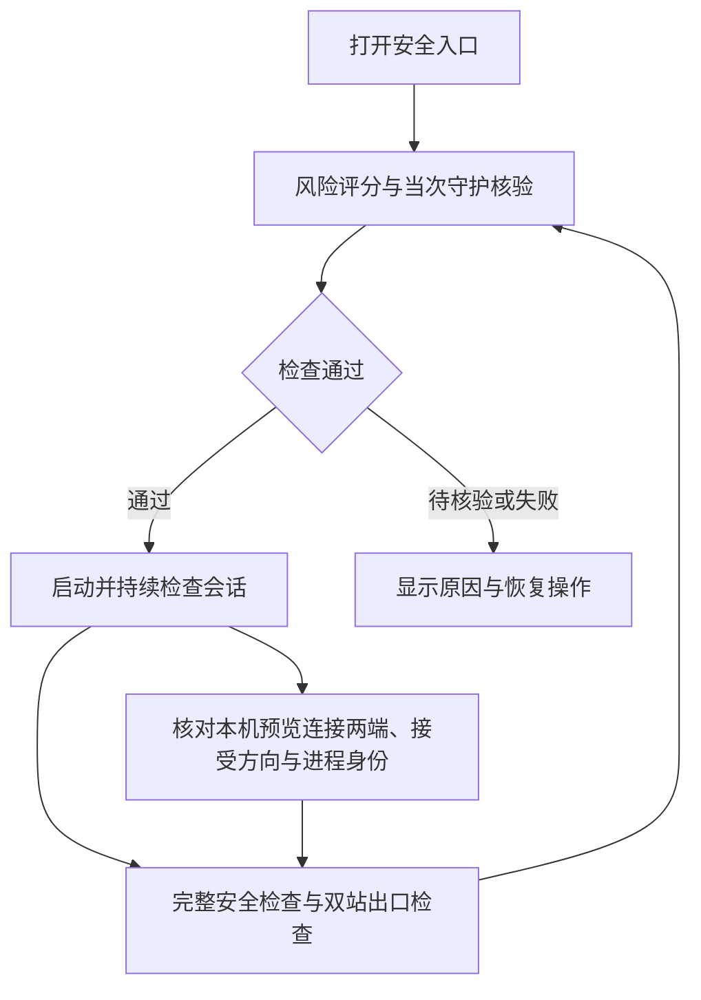
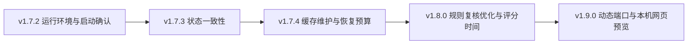

# Claude Code Protection Tool

面向 **Windows x64、Claude Desktop 及其本地 Code 会话**的桌面安全入口。项目提供专用代理、防火墙与执行门禁核验、后台守护、版本显示，以及官方 Desktop 和配套 Code 的受控更新。

当前源码基线：**v1.9.0 · 第 32 次源码迭代**。采用 [MIT 许可证](LICENSE)。本工具与 Anthropic 无隶属关系，不保证账号不受限制，也不改变服务的支持地区或使用政策。

让 Claude 启动项目的开发服务，然后在 Claude 内置浏览器打开它给出的回环地址，例如 `http://127.0.0.1:5173/?page=buy`。端口和页面路径由项目决定。服务可同时监听局域网供手机测试，Claude 使用回环地址；守护同时核验页面连接到的本机 API、进程身份和实际出站连接。

从普通终端独立启动的 Vite、Python `-m http.server` 和 Django `manage.py runserver` 也支持本机预览。其他框架、或终端已有自定义代理时，可在项目目录通过 `Start-ClaudeLocalPreview.ps1` 运行原开发命令。例如，在 PowerShell 7 中将 `$GuardRoot` 设为 ClaudeGuard 的安装目录，然后执行 `& "$GuardRoot\Start-ClaudeLocalPreview.ps1" -FilePath npm.cmd -ArgumentList @('run','dev')`。该命令为本次服务及其子进程设置专用环境。

现有部署升级后台宿主时，在同账号管理员 PowerShell 运行 `./Update-ClaudeSupervisorHost.ps1`。它保存旧宿主、部署和任务备份，在新守护完成连续两轮检查后返回结果。预检及中断恢复见 [部署说明](docs/DEPLOYMENT.md#升级已部署的后台宿主)。

## 能力

- 启动前核对当前安装版本、签名、程序哈希、代理策略、防火墙及当次守护就绪状态。
- 为 Desktop 和其指定版本的本地 Code 使用独立配置与专用代理；检测异常时暂停受保护启动，保留可核查的原因。
- 独立后台宿主托管守护，提供有限恢复、异常退避、固定出口检查及日志脱敏。关闭入口不等于退出 Desktop/Code。
- 支持经核准的 Xray VLESS Reality 节点池，按连接检测选择可用节点，并核对出口白名单；保留旧 sing-box 单节点配置兼容性。节点须单独导入并核验，不会自动信任共享代理中的所有节点。
- 显示已安装 Desktop、该包配套 Code、已核准 Code，以及实际观察到的本地 Code 运行版本。
- 查询官方 Windows x64 MSIX 当前发布，下载并核验官方包及配套 Code；更高版本才允许安装，安装后接续防护迁移和守护核验。
- 保存维护操作身份和最终结果，支持入口关闭重开接续，区分等待、明确授权取消、中断、失败和完成。
- v1.5.0 集成非 TUN 网络环境优化能力：提供本地代理 SOCKS5 / UDP Associate 探测、Chrome/Edge 用户级防 WebRTC UDP 与 DoH 泄露策略（可备份还原）、显式 `socks5://` 英文隔离检测浏览器、面向 `claude` / `codex` 等独立终端 CLI 的代理环境变量注入与连通性自检，以及入口「网络优化」交互面板。
- v1.6.0 新增启动前网络环境风险评分与门禁拦截，并采用简约现代卡片式重构安全入口 UI：内置 `0–100` 风险评分模型（`A+`–`D` 级）与可配置门限（默认 `≤ 20`），高于门限时在启动 Claude 前拦截并引导一键防泄露修复；入口与网络优化弹窗支持风险分实时刷新、门限开关/数值调节及扣分明细可视化，同时保留全部守护、更新与无障碍契约。
- v1.7.0 新增运行期动态网络风险巡检、静默自愈与分级阻断能力：针对启动 Claude 后共享代理掉线、系统代理/PAC 被第三方工具改写、CLI 代理环境变量丢失、浏览器防泄露策略被清除或网络切换导致风险分动态升高等场景，内置后台周期巡检（默认 25s）、可修复项静默自愈（自动重绑系统代理/PAC、恢复 CLI 环境变量与可写浏览器策略）以及四种运行期风控模式（`动态:自愈+告警`、`动态:超限停Claude`、`动态:仅预警`、`动态:关闭`）。

v1.3.2 将必要的安装前维护、官方包安装和安装后防护核验接入同一次“安装并维护”操作，无需先手动维护再回来安装；健康状态下直接安装。入口按实际进程刷新“Claude 已打开 / 打开 Claude”，安装期间显示“更新进行中”。资源占用失败仍保留已核验包供重试。

这里管理的是 **Desktop 内嵌元数据指定版本的本地 Code**。独立 CLI、SSH、WSL、云端会话及其他设备不属于当前观察和保护范围。

## 仓库边界

这是经过公开边界整理的源码仓库。账号凭据、节点配置、浏览器数据、部署状态、安装包、编译程序和原始验收记录均在本机保留，不随 GitHub 源码同步发布。

`ClaudeGuard.psm1` 初始化从本机 `private/bootstrap-local.json` 读取 `SourceConfig`、`CorePath`、`ExpectedIp` 和 `GuiConfig`。该文件由部署者单独准备。安全入口从 Windows 的 PythonCore 安装登记和当前普通用户的标准安装目录识别 64 位 CPython 3。启动和维护前会验证解释器可运行，启动后会核验本次客户端进程的实际运行环境。[PUBLICATION.json](PUBLICATION.json) 保留首次公开快照，历史测试见[验证记录](docs/VALIDATION.md)。

本仓库目前提供源码及开发者说明，**不是已经验收的通用一键安装包**。首次在其他机器部署，需要审查初始化参数、现有代理/策略、Code 缓存和防火墙，按 [部署说明](docs/DEPLOYMENT.md) 分阶段验收。不要把另一台机器的 `private` 目录复制过来使用。

## 环境与源码检查

需要 Windows x64、PowerShell 7.4 或更新版本、Node.js、Windows 64 位 CPython 3，以及 Windows 自带 .NET Framework C# 编译器。正式部署还需要官方 Claude Desktop、经本机核验的代理程序和同账号管理员授权。

克隆仓库后，在 PowerShell 7 中运行只使用隔离夹具的检查：

```powershell
git clone https://github.com/cr20085361/claude-code-protection-tool.git
Set-Location claude-code-protection-tool
New-Item -ItemType Directory -Path evidence,private -Force | Out-Null
pwsh -NoProfile -File .\Test-ClaudeDesktopCodeManifest.ps1
pwsh -NoProfile -File .\Test-ClaudeDesktopUpdate.ps1
pwsh -NoProfile -File .\Test-ClaudeMaintenance.ps1
pwsh -NoProfile -File .\Test-ClaudeSupervisorHealth.ps1
pwsh -NoProfile -File .\Test-ClaudeLifecycle.ps1
pwsh -NoProfile -File .\Test-ClaudeSupervisorHostUpgrade.ps1
pwsh -NoProfile -File .\Test-ClaudeVersionInfo.ps1
pwsh -NoProfile -File .\Test-ClaudeNodePool.ps1
pwsh -NoProfile -File .\Test-ClaudeProxyTracking.ps1
pwsh -NoProfile -File .\Test-ClaudeIterationVersionFixtures.ps1
pwsh -NoProfile -File .\Test-ClaudeNetworkEnv.ps1
pwsh -NoProfile -File .\Test-ClaudeIterationVersion.ps1
```

上述检查运行临时夹具和编译测试程序，不执行真实 MSIX 安装或生产防火墙迁移。原生窗口夹具和真实桌面、网络、管理员测试另见 [验证记录与边界](docs/VALIDATION.md)。其他 `Test-*Native*`、恢复和故障注入脚本可能操作已部署的专用组件，不应批量运行全部测试脚本。

迭代收尾规则见 [AGENTS.md](AGENTS.md)。构建前会检查版本台账、源码指纹、当前文档和界面常量；部署后还需以 `Test-ClaudeIterationVersion.ps1 -LauncherAssembly <实际 EXE>` 核对交付产物。历史补登记明确区分追溯版本和当时实际 EXE 版本。

## 主要模块

| 模块 | 职责 |
|---|---|
| `ClaudeGuardLauncher.cs`、`ClaudeGuard-UiBridge.ps1` | Windows Forms 入口、启动与检查、维护进度、网络优化面板 |
| `ClaudeGuard-NetworkEnv.psm1`、`Get-ClaudeNetworkEnv.ps1`、`Set-ClaudeWebRtcPolicy.ps1`、`Start-ClaudeSafeBrowser.ps1`、`Set-ClaudeCliProxy.ps1` | 非 TUN 网络环境基线诊断、SOCKS5/UDP 探测、浏览器防泄露策略、安全隔离浏览器与 CLI 代理适配 |
| `ClaudeGuard.psm1`、`ClaudeCodeGate.psm1` | 部署状态、代理策略、防火墙和 Code 执行门禁 |
| `ClaudeGuard-Lifecycle.ps1`、`ClaudeGuard-Health.ps1` | 操作关联、任务生命周期及当次守护就绪契约 |
| `ClaudeSupervisorHost.cs`、`ClaudeGuard-Supervisor-v2.ps1` | 独立宿主、守护、有限恢复及持久退避 |
| `ClaudeGuard-Runtime.psm1`、`Read-ClaudeProcessEnvironment.py` | 受保护进程身份、环境比较及连接核验 |
| `ClaudeGuard-VersionInfo.psm1`、`Get-ClaudeVersionInfo.ps1` | 安装和运行版本观察、官方发布查询 |
| `ClaudeGuard-DesktopUpdate.psm1`、`Invoke-ClaudeDesktopUpdate.ps1` | 官方包和配套 Code 下载核验、安装及维护接续 |
| `Update-ClaudeGuard.ps1`、`Repair-ClaudeCodeContext-Admin.ps1`、`ClaudeGuard-CacheRepair.psm1` | 版本防护迁移、双上下文缓存检查、有限预算与阶段证据、备份及回滚恢复 |
| `Read-DesktopCodeManifest.cjs`、`Expand-VerifiedCode.cjs` | 读取官方包内元数据、验证并解压配套 Code |

入口与后台宿主的 Windows x64 离线程序包及 SHA256 校验文件见 [GitHub Releases](https://github.com/cr20085361/claude-code-protection-tool/releases)。安装文件后，按[部署说明](docs/DEPLOYMENT.md)完成当前机器的防护配置和验收。版本沿革见 [CHANGELOG.md](CHANGELOG.md) 和 [.iteration-version.json](.iteration-version.json)。[PUBLICATION.json](PUBLICATION.json) 保留首次 v1.3.0 公开同步的历史校验值。

## 反馈与贡献

提交问题时请说明 Windows、Desktop/Code 和工具版本、操作步骤及脱敏后的状态提示。不要上传 `private`、浏览器用户目录、OAuth 链接、验证码、原始进程环境、节点订阅或含账号信息的日志。

修改核心安全门禁、生命周期、更新或回滚逻辑时，请提供对应隔离回归；真实桌面和跨机器结果分别报告，未运行的项目保留 `NOT_RUN`。

公开存档与本机部署源码各有精确指纹，登记在同一次迭代的 `public_source_fingerprint` 和 `source_fingerprint`。版本检查会报告匹配的副本；两种副本的未登记改动或混用均不通过。`.gitattributes` 保留原始字节。公开副本不含本机原始证据，`-VerifyLocalEvidence` 仅供持有这些本机材料的部署使用。

## 架构与运行流程






